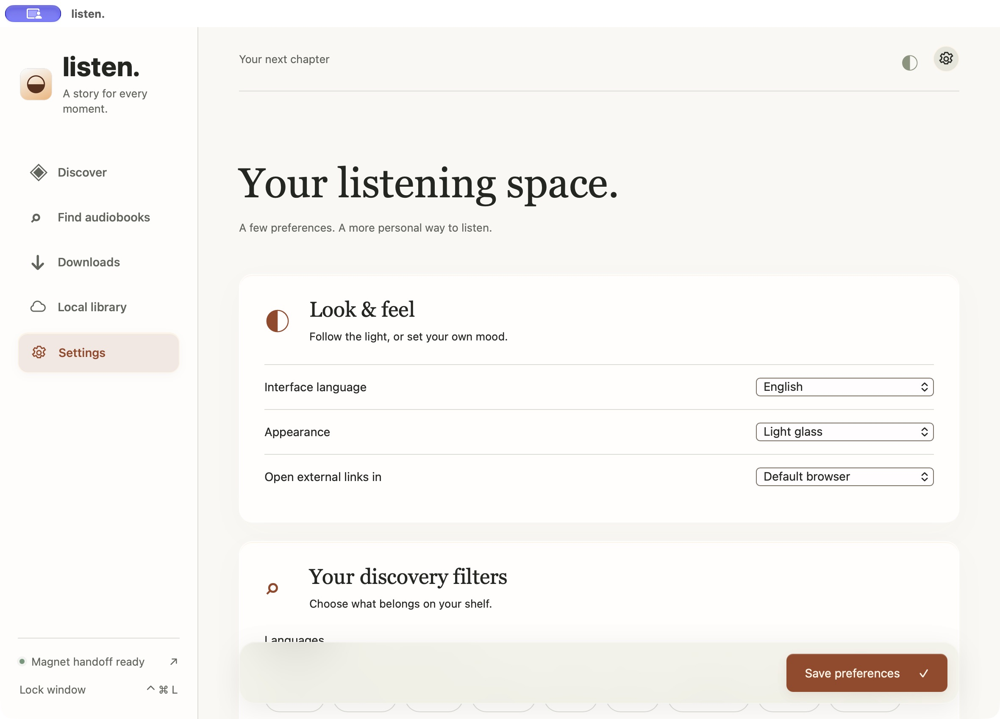

# listen.

[](https://github.com/Somamill/listen-desktop/issues) [](https://www.reddit.com/user/dot-app/)

[Issues](https://github.com/Somamill/listen-desktop/issues) | [Max on Reddit](https://www.reddit.com/user/dot-app/) | [Contact](#contact) | [Support Max on Ko-fi](https://ko-fi.com/somamill)

Audiobook discovery, torrent-client handoff and a local library for macOS.

**Independent from [sovo.](https://github.com/Somamill/sovo), the native Apple audiobook player.** listen. does not install, replace or use sovo.’s library.



*Actual native Mac window, version0.5.0. English and Arabic interfaces share the same controls.*

## Install

[Download listen. for Apple silicon Macs](https://github.com/Somamill/listen-desktop/releases/tag/v0.5.0). The DMG is signed with Developer ID and notarized by Apple. Open it and drag listen. into Applications.

To build the app from source on a Mac:

```sh
git clone https://github.com/Somamill/listen-desktop.git
cd listen-desktop
uv venv --python 3.13
uv pip install --python .venv/bin/python -e '.[build]'
.venv/bin/python scripts/build_macos.py --dmg
```

Open the locally built app, choose a torrent client in Settings, and select a library folder. With the default magnet handoff, any registered magnet-capable client can receive links without a WebUI login. Direct status/health and verified completed-file moves require the configured client integration.

## What it does

- Search catalog editions, filter audiobook languages/categories and rank matching editions by format and metadata.
- Bring Goodreads shelves via its independent in-app website session, CSV, Safari or a browser handoff. Goodreads availability and authentication are controlled by Goodreads; this is not a two-way API sync.
- Send chosen downloads to qBittorrent, Transmission, Deluge Web or the default magnet app. No download starts merely from importing a reading list.
- Show live client progress and available peer/seed health. Unknown or unavailable health stays explicit.
- Download locally first. Move completed books to your chosen library only when requested, verify files before removing a managed torrent, and retain pending cleanup across restart. Existing destinations are never overwritten.
- Check official desktop updates automatically once a day while the app runs, or manually from Settings, the Mac menu or `listen-update --check`. Checks never install or execute an update.

Only import or download content you are authorized to use. Catalog requests and Goodreads browsing use their own connections. A torrent proxy is not a VPN, and listen. does not guarantee anonymity or modify system networking.

## Current readiness

The independent source and self-contained arm64 ZIP/DMG build work locally. The Apple silicon DMG is signed and notarized for direct distribution. Ten interface catalogs include static screens, long-form guidance, dynamic status/errors and native menus. Interface language follows the supported system preferences or your selection, separately from audiobook filters. Arabic RTL and long-text layouts are checked below; provider website language remains controlled by that provider. See [release readiness](docs/RELEASE_READINESS.md).

[Arabic RTL interface](docs/images/native-arabic.png) · [Extraction and one-time migration](docs/EXTRACTION.md)

## Develop and verify

```sh
uv pip install --python .venv/bin/python pytest
.venv/bin/python -m pytest tests -q
.venv/bin/python scripts/check_frontend.py
.venv/bin/python scripts/build_macos.py --dmg
```

The app wraps an authenticated loopback Flask/Waitress service in a native AppKit/WebKit window. Credentials use the macOS credential store. Fresh-install tests use an isolated data directory. See [architecture/setup](docs/DEVELOPMENT.md), [privacy](docs/PRIVACY.md), [source extraction and compatibility](docs/EXTRACTION.md), [support](https://github.com/Somamill/listen-desktop/issues) and [license](LICENSE).

GitHub Actions remain disabled. Build, test and signing automation is local; no hosted checks or automated Store delivery are enabled.

## Contact

Questions, ideas, or spotted a bug? [Email Max](mailto:max@miller-max.com). Feedback is always welcome.

[Support Max on Ko-fi](https://ko-fi.com/somamill)
