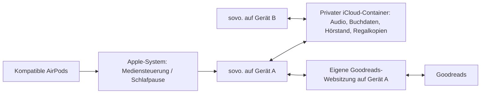

# sovo. — iCloud, Goodreads und AirPods

Recherche vom **18. November 2026**. „Airport“ wird hier entsprechend dem bisherigen Projektverlauf als **AirPods einschließlich automatischer Schlafpause** verstanden. Grundlage sind Apple-Dokumentation, Goodreads-Seiten, öffentliche Implementierungen, Reddit-Berichte und der lokale sovo.-Quellcode. Dies ist eine Machbarkeits- und Integrationsdokumentation, keine Bestätigung eines neuen Gerätetests.

**Quellcode-Ausgangsstand:** `e3c5b73`, vor der Umsetzung in Build 9. Die nachfolgenden Beschreibungen und offenen Punkte dokumentieren diesen Forschungsstand. Den neueren Implementierungs- und Prüfstand enthält [Integration QA — Build 9](INTEGRATION-QA.de.md).

## Ergebnis

| Integration | Machbarkeit | Vorhandener Stand | Was noch nachgewiesen werden muss |
| --- | --- | --- | --- |
| iCloud-Bibliothek und Hörposition | Ja, mit Apples iCloud-Dokumenten und Zustandsabgleich | Dateien, Buchdaten, Fortschritt und Goodreads-Regalkopien werden bereits verarbeitet | Echter Abgleich zwischen zwei angemeldeten Geräten; Konflikte, Kontowechsel und abgeschlossene Übertragung |
| Goodreads unabhängig von Safari | Ja, über eine eigene persistente Website-Sitzung | Eigene Anmeldung und lesender Regalimport vorhanden | Aktuelle Anmeldung, private Regale, abgelaufene Sitzung und tatsächliche Aktualisierung |
| Automatisch zu Goodreads zurückschreiben | Inoffiziell technisch möglich; kein belastbarer neuer öffentlicher API-Zugang gefunden | Nicht implementiert | Dienstbedingungen/Zulässigkeit, Sitzungspflege, sichere Buchzuordnung und Konfliktverhalten |
| AirPods-Steuerung und systemseitige Schlafpause | Ja, über Apples normale Medienintegration und unterstützte Hardware | Medienbefehle, Pause, Positionsspeicherung, Unterbrechungs- und Routenbehandlung vorhanden | Zusammenspiel mit echten kompatiblen AirPods und aktiviertem Systemschalter |
| Schlaf anhand des AirPods-Pulses selbst erkennen | Kein geeigneter allgemein dokumentierter Weg für diesen Player gefunden | Nicht implementiert | Nicht als Produktversprechen vorsehen; Apples Medien-Schlafpause verwenden |

**Empfehlung:** Die bestehende native Architektur gezielt absichern. Kein eigener Cloudserver, kein permanent laufender Browser und keine selbst entwickelte medizinische Schlaferkennung sind dafür erforderlich.

## Welche Anmeldung wofür gebraucht wird

| Zugang | Zweck | Zeitpunkt |
| --- | --- | --- |
| Apple Account in den Geräteeinstellungen, iCloud Drive aktiviert | Private Bibliothek dieses Nutzers synchronisieren | Auf jedem beteiligten Gerät |
| Apple-Developer-/App-Store-Connect-Webanmeldung | Signierung, Berechtigungen und Veröffentlichung verwalten | Später durch den Eigentümer; nicht Voraussetzung zum lokalen Lesen dieses Berichts |
| Goodreads-Anmeldung innerhalb von sovo. | Nicht öffentliche Goodreads-Seiten für dieses Konto lesen | Bei erster Verbindung und erneut, wenn Goodreads die Sitzung beendet |
| AirPods-Kopplung und Systemeinstellung | Audio und gegebenenfalls Schlafpause | Am Wiedergabegerät; kein zusätzliches sovo.-Konto |

Die Developer-Webanmeldung verbindet **nicht** automatisch die iCloud-Bibliothek eines Endnutzers. Eine Goodreads-Anmeldung in Safari verbindet auch nicht automatisch die separate Website-Sitzung der App.

Goodreads-Cookies und Passwörter gehören nicht in die synchronisierte Regalkopie. Eine systemseitige Pause speichert den Hörstand; sie liefert der App keinen verlässlich unterscheidbaren Beweis, dass der Nutzer eingeschlafen ist.

## 1. iCloud: Dateien und Zustand getrennt betrachten

### Plattform und Voraussetzungen

Apple übernimmt die Übertragung von Dateien im Ubiquity-Container asynchron. Ein erfolgreicher lokaler Schreibvorgang bedeutet daher nicht, dass ein anderes Gerät die Datei bereits vollständig herunterladen kann. Dateizugriffe müssen mit dem iCloud-Dateisystem koordiniert werden. Apples Dokumentationsbeispiel behandelt außerdem konkurrierende Offline-Änderungen und Dateiversionen. [Apple: iCloud File Management](https://developer.apple.com/library/archive/documentation/FileManagement/Conceptual/FileSystemProgrammingGuide/iCloud/iCloud.html), [Apple: Synchronizing documents](https://developer.apple.com/documentation/uikit/synchronizing-documents-in-the-icloud-environment).

Erforderlich sind ein entsprechend signierter Build mit den passenden iCloud-Berechtigungen, der zugewiesene Container, iCloud Drive, derselbe Apple Account auf den beteiligten Geräten sowie ausreichend Speicher und eine Verbindung. Lokales Importieren und Abspielen müssen auch ohne iCloud funktionieren. Ein Simulator- oder unsignierter Build beweist nicht, dass die Produktionsberechtigungen stimmen.

### Was der aktuelle Code tatsächlich macht

In [`CloudLibrary.swift`](../Listen/Services/CloudLibrary.swift) wird der bestehende Container `iCloud.io.github.somamill.listen.mobile` verwendet. Die historische Bundle-/Containerkennung bleibt trotz der Marke sovo. bestehen, damit bestehende Daten und Berechtigungen nicht durch eine reine Umbenennung verloren gehen.

- Audio und Cover werden koordiniert und über temporäre Dateien kopiert. Bücher werden über eigene Manifestdateien erkannt; Inhalte können bei Bedarf lokal heruntergeladen werden.
- Änderungen lösen einen verzögerten Abgleich aus; zusätzlich läuft während der App-Ausführung ein 60-Sekunden-Timer. Das ist kein garantierter Hintergrunddienst.
- Hörpositionen nutzen unter anderem einen `progress-<Buch-ID>`-Schlüssel im iCloud-Key-Value-Store; auch die Buchdaten enthalten Fortschrittsinformationen. Aktuell abgespielte Bücher werden beim Einlesen entfernter Buchdaten ausgespart, um Sprünge zu vermeiden.
- Goodreads-Regale werden als validierte, größenbegrenzte JSON-Schnappschüsse pro Gerät abgelegt. Anmeldung und Sitzungscookies werden nicht mitgeschrieben.
- Audio und Cover erhalten koordinierte Dateizugriffe. Die JSON-Manifeste werden atomar geschrieben; eine ausdrücklich koordinierte JSON-Konfliktauflösung ist damit noch nicht nachgewiesen.

Der App-Container ist **nicht** automatisch der beliebige persönliche Ordner „iCloud Drive/4. Archive/Audio/Audiobooks“. Für einen frei gewählten Zielordner braucht es eine explizite Files-/Ordnerauswahl und gegebenenfalls gerätespezifische Zugriffsberechtigungen. Ein fest eingebauter Mac-Benutzerpfad wäre für andere Nutzer ungeeignet. Ebenso ist nicht belegt, dass sämtliche zusätzlich aufbewahrten Importoriginale mit hochgeladen werden: maßgeblich sind die aktuellen Buchdateien, Cover und Manifeste.

### Grenzen und nötige Absicherung

Apples Key-Value-Store erlaubt **1024 Schlüssel und insgesamt 1 MB Werte**. Der aktuelle Schlüssel pro Buch kann bei großen Bibliotheken an diese Grenze stoßen. Das bedeutet nicht automatisch den Verlust aller Buchdaten, verlangt aber Quotenbehandlung statt stiller Erfolgsanzeige. Zugangsdaten gehören laut Apple nicht in diesen Speicher. [Apple: NSUbiquitousKeyValueStore](https://developer.apple.com/documentation/foundation/nsubiquitouskeyvaluestore).

Aus dem Code ergeben sich folgende offene Punkte, keine bereits bewiesenen Datenverluste:

1. **Übertragungsstatus:** „Abgleich abgeschlossen“ sollte lokale Verarbeitung, laufenden Upload und vollständig lokal verfügbares Audio unterscheiden. Gegenwärtig ist die Serverübertragung damit nicht abschließend bestätigt.
2. **JSON-Konflikte:** Zwei Geräte können offline denselben Buchstand ändern. Versionsvergleich und koordinierte Manifestzugriffe benötigen einen reproduzierbaren Test. Ein neuerer bewusster Rücksprung darf nicht einfach vom numerisch höheren Fortschritt überschrieben werden.
3. **Kontowechsel:** Ein expliziter iCloud-Identitätswechsel-Handler ist in der geprüften Implementierung nicht vorhanden. Zwischengespeicherte Container und fremde Kontodaten dürfen nicht versehentlich weiterverwendet werden.
4. **Löschen:** `LibraryStore.remove` entfernt ausdrücklich nur die lokale Kopie. Ein anderes Gerät beziehungsweise iCloud kann das Buch wieder bereitstellen. „Überall löschen“ wäre eine eigene Funktion mit Löschmarkierung und Bestätigung.
5. **Dateiverfügbarkeit:** Große oder ausgelagerte Dateien, wenig Speicher und unterbrochene Downloads brauchen verständliche Zustände und Wiederaufnahme. Der bestehende Hydrierungsversuch wartet begrenzt; eine Zeitüberschreitung ist kein Nachweis einer kaputten Datei.

Für eine spätere stärker strukturierte Zustandsverwaltung ist `CKSyncEngine` eine Apple-Option. Es ersetzt weder Fehlerbehandlung noch Konfliktregeln. Ein kompletter Wechsel ist für diese Recherche nicht notwendig. **CloudKit-Produktionsschemas betreffen eine solche CloudKit-Lösung; die aktuelle CloudDocuments-Implementierung benötigt nicht nachträglich ein CloudKit-Schema.** [Apple WWDC: Sync to iCloud with CKSyncEngine](https://developer.apple.com/videos/play/wwdc2023/10188/).

## 2. Goodreads: lesende Verbindung und Schreibzugriff unterscheiden

### Offizieller Zugang und belastbare Alternative

Die Goodreads-Entwicklerdiskussion dokumentiert die Ankündigung, dass seit dem **8. Dezember 2020 keine neuen öffentlichen API-Schlüssel** ausgegeben werden. Es handelt sich dort um eine Diskussion, die den damaligen Goodreads-Banner wiedergibt, nicht um eine neu veröffentlichte offizielle Schnittstellenzusage. Die aktuelle API-Adresse leitete bei dieser Recherche auf eine JavaScript-/Botprüfung weiter. Ein unterstützter neuer OAuth-Zugang für sovo. wurde nicht gefunden. Das schließt individuelle Partnerschnittstellen nicht aus. [Goodreads: API Deprecation](https://www.goodreads.com/topic/show/21788520-api-deprecation), [Goodreads: API-Adresse](https://www.goodreads.com/api).

Der Import-/Exportbereich der vollständigen Goodreads-Website ist ein sinnvoller Rückfallweg: CSV exportieren und in der App importieren. Das ergibt eine bewusste Momentaufnahme, keine dauerhafte Verbindung. Der reale Export mit dem Nutzerkonto wurde jetzt nicht getestet; eine ältere Help-URL lieferte 404, andere Hilfeseiten Darstellungsprobleme. Der aktuelle Menüpfad und die verfügbaren Felder sind deshalb nach der Anmeldung zu bestätigen. [Goodreads: Import/Export](https://www.goodreads.com/review/import).

### Safari-unabhängige Sitzung

Apple stellt mit `WKWebsiteDataStore.default()` einen persistenten Datenspeicher für die eigene WebView bereit. Diesen verwendet [`GoodreadsConnection.swift`](../Listen/Services/GoodreadsConnection.swift) bereits. Die App kann damit eine eigene Goodreads-Sitzung behalten, während Safari geschlossen ist. Persistenz bedeutet allerdings nicht, dass Goodreads eine Sitzung unbegrenzt akzeptiert. [Apple: WKWebsiteDataStore](https://developer.apple.com/documentation/webkit/wkwebsitedatastore).

Ein externer Browser ist bei normalem OAuth gut geeignet, wenn der Anbieter einen registrierten Client und eine Rückleitung unterstützt. `ASWebAuthenticationSession` ist Apples dafür vorgesehener Mechanismus. Ein bloßer Link zur Goodreads-Anmeldeseite liefert sovo. jedoch noch kein unterstütztes Token und keine angemeldete eigene WebView. Safari-/Chrome-Cookies auszulesen oder deren Profil zu kopieren ist hier nicht der Lösungsweg. [Apple: ASWebAuthenticationSession](https://developer.apple.com/documentation/authenticationservices/aswebauthenticationsession).

Der aktuelle Adapter liest Website-Inhalte und speichert Regalkopien. Ein 300-Sekunden-Timer kann während laufender App aktualisieren. Er schreibt **keinen** Hörfortschritt, keine Bewertungen und keine Regalwechsel zu Goodreads zurück. Eine reine Profil-URL reicht für öffentliche Daten; private Inhalte brauchen eine gültige Sitzung. Auf jedem Gerät kann eine eigene Anmeldung notwendig bleiben, auch wenn die zuletzt gelesenen Regale über iCloud sichtbar sind.

### Was andere Projekte praktisch zeigen

Die öffentliche **MIT-Implementierung ShelfSync** ist eine konkrete technische Referenz für inoffizielle Goodreads-Aktionen. Geprüfter Quellstand: `9ef011eca72d377ddc50ca36dd5573db782daabb`. Sie arbeitet mit Sitzungscookies, CSRF-Werten und Website-/AJAX-Endpunkten. Der Code wurde ausschließlich gelesen, nicht mit Nutzerzugängen ausgeführt. Die Implementierung zeigt die Machbarkeit, aber keine stabile, offiziell unterstützte API. [ShelfSync: Quellcode und Dokumentation](https://github.com/Lyfts/ShelfSync).

Für sovo. wären daraus vor einem optionalen Schreibadapter folgende eigene Anforderungen abzuleiten:

- Buchausgabe anhand Goodreads-ID/ISBN und Titel/Autor zuordnen; unklare Treffer bestätigen lassen. Hörzeit in Prozent ist nicht automatisch dieselbe Seitenposition einer Druckausgabe.
- `to-read`, `currently-reading` und `read` ausdrücklich auf die lokalen Leseregale abbilden. Lokale Warteschlange und Lesezeichen bleiben eigenständige Daten.
- Schreibzugriff gesondert freigeben; veraltete Offline-Aufträge verwerfen oder rückfragen, statt einen neueren Goodreads-Stand zu überschreiben.
- Nach einer Änderung den verfügbaren Zielzustand prüfen. Wo ein exakter Fortschritt nicht zurückgelesen werden kann, keinen bestätigten beidseitigen Abgleich anzeigen.
- Bei Anmeldung, CAPTCHA, Rate-Limit oder geänderter Seite stoppen und den letzten gültigen Cache behalten. Eine Anmeldeseite darf nicht als „leeres Regal“ alle Bücher entfernen.
- Cookies nur an den vorgesehenen Host senden; keine Passwörter, Sitzungsdaten oder CSRF-Werte in Logs, Git oder iCloud-Regaldateien schreiben.

Der ShelfSync-Autor beschreibt auf Reddit selbst die begrenzte Rücklesbarkeit des Goodreads-Fortschritts. In der Version-1.7.0-Beschreibung erhalten Fortschrittsaufträge deshalb eine kurze Ablaufzeit. Das ist ein nützliches Konfliktbeispiel, keine Zusage für sovo. [Entwicklerbericht vom 26. August 2026](https://www.reddit.com/r/koreader/comments/1vz510k/release_shelfsync_sync_reading_progress_to/), [Versionbericht vom 8. Oktober 2026](https://www.reddit.com/r/koreader/comments/1x10vda/shelfsync_170_sync_koreader_with_storygraph/).

Ein weiteres Projekt hält Cookies mittels angemeldetem Chrome, Selenium und Docker frisch. Dafür müsste ein zusätzlicher Rechner mit Browserprofil erreichbar bleiben; das ist kein eigenständiger iPhone-Login und weiterhin von Sitzungsablauf abhängig. Für die gewünschte einfache mobile Nutzung ist es keine bevorzugte Voraussetzung. Es wurde nicht installiert oder gestartet. [goodreads-cookie-refresher](https://github.com/Lyfts/goodreads-cookie-refresher).

Vor öffentlicher Freigabe eines inoffiziellen Adapters sind Goodreads-Bedingungen und Apples Anforderungen für Drittanbieterdienste zu prüfen. Öffentlich verfügbarer Beispielcode ist keine Zugriffserlaubnis des Dienstes. [Apple Review Guidelines, insbesondere 5.2.2](https://developer.apple.com/app-store/review/guidelines/).

### Was „automatisch“ realistisch heißt

Nach erfolgreicher Verbindung kann die App bei Öffnen, Rückkehr in den Vordergrund und auf ausdrückliche Aktualisierung Regale nachladen. Ein Hintergrundauftrag ist ergänzend möglich, aber iOS bestimmt seine Ausführung. Dauerhaftes Polling durch einen normalen Timer funktioniert im suspendierten Zustand nicht. Hintergrundaudio darf nur tatsächlicher Wiedergabe dienen. Deshalb sollte die Oberfläche „zuletzt aktualisiert“, Offline-Cache und „erneut verbinden“ zeigen, statt „immer live“. [Apple: Choosing Background Strategies](https://developer.apple.com/documentation/backgroundtasks/choosing-background-strategies-for-your-app).

## 3. AirPods: systemseitige Schlafpause statt Puls-Experiment

### Unterstützte Funktion und Einrichtung

Apple beschreibt das automatische Pausieren beim Einschlafen für **AirPods 4 oder nachfolgende Modelle sowie AirPods Pro 2 oder nachfolgende Modelle**. Die aktuelle separate Anleitung bestätigt außerdem **AirPods Max 2**. Max der ersten Generation sollte damit nicht ohne Prüfung gleichgesetzt werden. [Apple: AirPods-Einstellungen](https://support.apple.com/en-in/108764), [Apple: AirPods Max, Anleitung für Version 27](https://support.apple.com/en-euro/guide/airpods/dev3e3e8821d/27/web/27).

| Funktion | Voraussetzung | Bedeutung für sovo. |
| --- | --- | --- |
| Wiedergabe-/Pausetaste | Normale kompatible Audioverbindung | Öffentliche Medienbefehle verarbeiten |
| Automatische Ohr-/Kopferkennung | Modell und aktivierte Systemeinstellung | Andere Funktion als Einschlafen; Herausnehmen ist kein Schlafnachweis |
| Pause beim Einschlafen | Unterstütztes Modell, kompatibles aktuelles Betriebssystem/Firmware, aktivierter Schalter | Tatsächliche Systempause respektieren und Hörstand sichern |
| Herzfrequenzmessung | AirPods Pro 3, unterstützte Trainingsfunktion und Berechtigungen | Für die gewöhnliche Schlafpause nicht erforderlich |

Einrichtung laut Apple: AirPods tragen und verbinden → Geräteeinstellungen → AirPods → gegebenenfalls **Audio & Routing** → **Pause Media When/While Falling Asleep** aktivieren. Die genaue deutsche Beschriftung und Verfügbarkeit sind am realen Gerät zu prüfen. Für AirPods Max 2 nennt Apple denselben Funktionsbereich. Eine Apple Watch wird in diesen offiziellen Voraussetzungen für die Medien-Schlafpause nicht verlangt.

Die geprüfte aktuelle Anleitung gilt für die Version-27-Systemgeneration. Eine exakte älteste unterstützte OS-/Firmwarekombination für jedes Modell wurde nicht abschließend verifiziert. Die Mindestversion der sovo.-App allein garantiert diese Kopfhörerfunktion daher nicht. Ein öffentlich dokumentierter API-Schalter, mit dem sovo. sie selbst aktiviert oder ihren Zustand zuverlässig abfragt, wurde nicht gefunden.

### Integration im Player

Apples reguläre Schnittstellen sind `MPRemoteCommandCenter` und Now-Playing-Informationen. Der Player muss auf Pausen reagieren, den Hörstand speichern und Unterbrechungen sowie Routenwechsel sauber verarbeiten. Dafür ist kein eigener Bluetooth-Scanner nötig. [Apple: Remote Command Center Events](https://developer.apple.com/documentation/mediaplayer/remote-command-center-events), [Apple: Becoming a Now Playable App](https://developer.apple.com/documentation/mediaplayer/becoming-a-now-playable-app).

[`AudioController.swift`](../Listen/Services/AudioController.swift) besitzt bereits Medienbefehle und Positionsspeicherung, pausiert bei relevanten Unterbrechungen beziehungsweise verlorenem Audiogerät und schützt vor dem Start des nächsten Buchs durch ein verspätetes Abschlussereignis nach einer Pause. Das ist die passende Grundlage. **Es beweist noch nicht**, dass Apples Schlafpause mit dem hochgeladenen Build auf den persönlichen AirPods durchgehend funktioniert. Auch lässt sich aus einem allgemeinen Pausebefehl nicht sicher dessen Ursache ablesen.

Ein manueller Schlaftimer und Kapitelende bleiben sinnvolle Alternativen. Wiederherstellungs-Lesezeichen helfen beim Zurückspringen. Ein Kopfhörerwechsel sollte keine unerwartete automatische Wiederaufnahme nach dem Einschlafen auslösen.

### Warum Puls nicht die Abkürzung ist

Apple dokumentiert die Herzfrequenzmessung der AirPods Pro 3 im Zusammenhang mit **Training**: unterstützte App, Berechtigungen, Training starten; beim Beenden endet die Messung. Das ist keine dokumentierte allgemeine Schlafzustands-Schnittstelle für einen Hörbuchplayer. Ein niedriger Puls allein erlaubt außerdem keine verlässliche Schlafentscheidung. [Apple: Track heart rate during workouts](https://support.apple.com/guide/airpods/track-heart-rate-workouts-airpods-pro-3-dev1b40fb47d/27/web/27).

sovo. sollte dafür weder ein Scheintraining starten noch Gesundheitsdaten sammeln, die für die gewünschte Wiedergabefunktion nicht gebraucht werden. Eine spätere eigene HealthKit-Funktion wäre ein getrenntes, ausdrücklich begründetes Vorhaben. Hier werden keine medizinische Genauigkeit und keine eigene Schlafdiagnose zugesagt.

### Reddit: nützliche Fälle, keine Zuverlässigkeitsmessung

| Bericht | Beobachtung | Konsequenz |
| --- | --- | --- |
| [15. April 2026, r/airpods](https://www.reddit.com/r/airpods/comments/1smc27e/does_the_feature_that_pauses_media_when_you_fall/) | Gemischte Erfahrungen: funktioniert, pausiert zu früh oder erfordert Zurückspulen | Ruhiges Wachliegen und echten Schlaf getrennt prüfen; Timer behalten |
| [16. September 2026, r/airpods](https://www.reddit.com/r/airpods/comments/1whs279/what_airpods_feature_sounded_unnecessary_until/) | Positive Berichte über Podcast-/Hörbuchpausen | Praktischer Nutzen plausibel, keine garantierte Erkennung |
| [29. September 2026, r/airpods](https://www.reddit.com/r/airpods/comments/1wtp4cf/pausing_while_falling_asleep_broken/) | Einzelner Bericht über ausbleibende Pause nach einem Update | Konkrete Modell-/OS-Kombination testen; kein belegter allgemeiner Systemfehler |
| [21. März 2026, r/iCloud](https://www.reddit.com/r/iCloud/comments/1s00bc5/2631_killed_icloud/) | Nutzer berichtet über stockende Dateiübertragung | Übertragungsstatus und Offline-Verhalten testen; keine globale Ausfallfeststellung |

Der zusätzliche AirPods-Beitrag vom 30. September ist ein Crosspost desselben Falls und keine unabhängige Bestätigung. Vermutungen aus Kommentaren über Sensoralgorithmen oder eine notwendige Watch werden nicht als Apple-Spezifikation übernommen.

## 4. BookPlayer als Referenz

[BookPlayer](https://github.com/TortugaPower/BookPlayer) bleibt eine öffentliche Verhaltensreferenz für Import, Wiedergabe, Schlaftimer und Wiederherstellung. Die bereits dokumentierte [BookPlayer-Gegenüberstellung](BOOKPLAYER-PARITY.md) unterscheidet beobachtete Funktionen von sovo.s eigener Implementierung. BookPlayer-Quellcode oder ein angebotener Syncdienst sind keine automatisch übertragbaren Serverzugänge, App-Entitlements oder Goodreads-Berechtigungen. Diese Recherche übernimmt keinen GPL-Code und keine fremden Dienstschlüssel.

## 5. Praktischer Prüfplan für später zu Hause

Die Anmeldung kann warten. Für diese Recherche wurden keine Zugangsdaten abgefragt, keine Cookies aus persönlichen Browsern ausgelesen und keine Veröffentlichung ausgelöst.

| Test | Durchführung | Erfolgskriterium |
| --- | --- | --- |
| iCloud-Grundabgleich | Signierten aktuellen Build auf zwei Geräten mit demselben Apple Account öffnen; eigenes Testhörbuch importieren | Metadaten und vollständiges abspielbares Audio erscheinen auf Gerät B |
| Hörposition | Auf A hören, pausieren, auf B öffnen; danach bewusst zurückspringen und erneut wechseln | Neuerer bewusster Stand bleibt erhalten, kein Sprung während laufender Wiedergabe |
| Offline-Konflikt | Beide Geräte offline ändern, dann nacheinander verbinden | Dokumentierte Konfliktregel; keine beschädigten Manifeste oder still verlorenen Bücher |
| Große/ausgelagerte Datei | Download unterbrechen, Datei auslagern, erneut öffnen; Speichergrenze prüfen | Verständlicher Status, kontrollierter Fehler und erneuter Versuch |
| Kontowechsel und Löschen | Nur mit entbehrlichen Testdaten durchführen | Keine Übernahme zwischen Konten; lokales Entfernen klar von Cloud-Löschen unterschieden |
| Goodreads-Verbindung | In sovo. anmelden, Safari schließen, App neu öffnen; öffentliche und private Regale prüfen | Eigene Sitzung funktioniert; Want to Read / Currently Reading / Read bleiben getrennt |
| Goodreads-Ablauf/Offline | Sitzung beenden beziehungsweise Verbindung unterbrechen | Letzter Cache bleibt sichtbar; erneute Anmeldung statt leerem Regal |
| Goodreads auf Gerät B | Regalkopie über iCloud prüfen, anschließend eigene Aktualisierung versuchen | Sichtbarer Cache erweckt nicht den Eindruck einer automatisch übertragenen Anmeldung |
| AirPods-Steuerung | Play/Pause, Herausnehmen, Sperrbildschirm, Routenwechsel und Warteschlange testen | Pause speichert Position; nächstes Buch startet nicht unerwartet |
| AirPods-Schlafpause | Modell, OS, Firmware und Schalter dokumentieren; aktiviert/deaktiviert vergleichen | Tatsächliche Pause und erhaltene Position; ausbleibende Erkennung führt nicht zum Verlust des Timers |

Ein Hörtest und eine echte Einschlafsituation brauchen den Nutzer; ein Simulator kann das nicht ersetzen. Die vorhandenen Regressionstests (zuletzt 41 erfolgreiche Fälle je iPhone-/iPad-Simulator, je ein berechtigungsabhängiger Keychain-Test übersprungen) sind kein Nachweis für privaten Goodreads-Zugang, zwei reale iCloud-Geräte oder AirPods-Schlafsensorik im Build 8.

## 6. Reihenfolge für eine spätere Umsetzung

1. **Bestehendes absichern:** iCloud-Status, koordinierte JSON-Zugriffe, Konflikte/Kontowechsel/Quoten und die reale Goodreads-Cache-Aktualisierung prüfen.
2. **Einfach verständlich machen:** letzter Abgleich, lokale Verfügbarkeit, erneute Goodreads-Verbindung und AirPods-Systemanleitung sichtbar erklären. Keine „immer verbunden“-Garantie.
3. **Hardwaretest durchführen:** normaler Pausepfad, Warteschlange und tatsächliche Schlafpause; vorhandenen Timer als Alternative behalten.
4. **Goodreads-Schreiben gesondert entscheiden:** erst nach Dienstbedingungenprüfung und mit ausdrücklich freigegebenem, fehlertolerantem Adapter. Lesende Integration und lokale Lesestatistik bleiben unabhängig davon nutzbar.

**Abgrenzung:** Diese Änderung dokumentiert Recherche und Quellcodeprüfung. Sie implementiert keine neue Schnittstelle und bestätigt keine heutige Anmeldung, Gerätesynchronisierung oder Hardwarefunktion. Einzelne Goodreads-/Apple-Hilfeseiten waren nicht vollständig abrufbar; an diesen Stellen sind Grenzen ausdrücklich genannt. Reddit-Berichte sind anekdotisch und ersetzen keine Plattformdokumentation oder eigene Tests.
